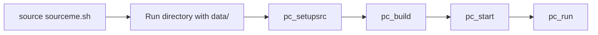
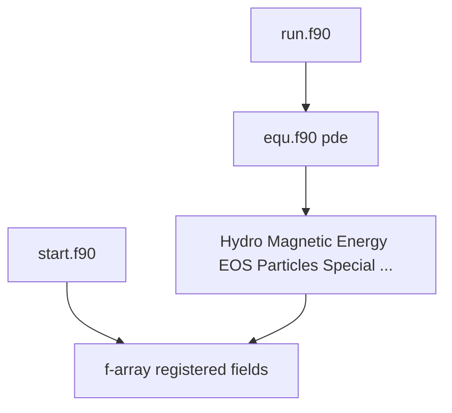

# Pencil Code — structure and usage

This note summarizes how the repository is organized, how simulations are usually run, and where to change the code. It is meant for developers and for **automated agents** that need a single entry point to navigate the tree and plan feature work. It does **not** replace the official manual (namelists, algorithms, and physics in full detail).

**Official documentation:** [documentation overview](https://pencil-code.org/doc.php), [manual (PDF)](https://github.com/pencil-code/website/raw/master/doc/manual.pdf), [quick start (PDF)](https://github.com/pencil-code/website/raw/master/doc/quick_start.pdf), [ReadTheDocs](https://pencil-code.readthedocs.io/en/latest/index.html). See also the root [README.md](README.md).

---

## What this code is

The Pencil Code is a **high-order finite-difference** solver for **compressible hydrodynamics** with optional **magnetic fields**, **particles** (e.g. dust, cosmic rays, super-particle schemes), **chemistry**, **radiation**, **gravity**, and many specialized physics modules. It is **modular Fortran**, parallelized with **MPI**, and selects a small subset of source files per run via `Makefile.local`.

---

## Top-level directory map

| Path | Role |
|------|------|
| [src/](src/) | Fortran sources: physics modules, time integration, I/O, GPU hooks ([src/astaroth/](src/astaroth/) for Astaroth/GPU). **Do not compile inside the checkout `src/` tree for real runs** — see [src/README](src/README). |
| [samples/](samples/) | Example setups; bulk of [auto-tests](#testing-and-contributions) live here — see [samples/README.md](samples/README.md). |
| [bin/](bin/) | Shell tools prefixed with `pc_` (`pc_setupsrc`, `pc_build`, `pc_run`, …); see [bin/README](bin/README). |
| [config/](config/) | Host and compiler configuration; machine-specific files under [config/hosts/](config/hosts/). |
| [doc/](doc/) | Manual sources and implementation notes; see [doc/implementation/](doc/implementation/) (e.g. [doc/implementation/README.md](doc/implementation/README.md) on `*.inc` conventions). |
| [python/](python/) | Python package and tooling for reading and analyzing data; tutorials under [python/tutorials/](python/tutorials/) ([python/tutorials/README_FIRST](python/tutorials/README_FIRST)). |
| [idl/](idl/) | Legacy IDL macros and libraries for post-processing. |
| [utils/](utils/) | Extra scripts and helpers (not all documented in one place). |
| [tests/](tests/) | Focused tests (e.g. Python read tests); most regression coverage is via `samples/` — see [tests/README](tests/README). |
| [remesh/](remesh/) | Remeshing utilities. |
| [julia/](julia/) | Julia-related material — see [julia/README.md](julia/README.md). |
| [dx/](dx/) | OpenDX macros. |
| [mathematica/](mathematica/) | Mathematica helpers (e.g. plotting). |
| [license/](license/) | License and [code of conduct](license/CODE_OF_CONDUCT.md). |

Other top-level items ([bugs/](bugs/), [misc/](misc/), etc.) are ancillary; start from the table above for application work.

Environment setup: [sourceme.sh](sourceme.sh) sets `PENCIL_HOME`, extends `PATH` with [bin/](bin/) and utilities, and configures `PYTHONPATH` / `IDL_PATH` for analysis.

---

## Standard workflow: run directory model

Simulations are driven from a **run directory** (often copied from [samples/](samples/) with `pc_newrun` or similar). That directory holds input files, a `data/` subdirectory for output, and **symlinks** into the repository so the compiler sees the right `src/`. [pc_setupsrc](bin/pc_setupsrc) generates the run `Makefile`.

Typical commands (from [README.md](README.md)):

1. `source sourceme.sh` (or set `PENCIL_HOME` and source quietly from your shell rc).
2. `cd` to a run directory; `mkdir data` if needed.
3. `pc_setupsrc` — prepare links and Makefile.
4. `pc_build [-f /path/to/host.conf]` — compile **from the run directory**, not from the bare [src/](src/) checkout.
5. `pc_start [-f ...]` — build initial conditions; runs the `start` executable.
6. `pc_run [-f ...]` — time integration; runs the `run` executable.

Host/compiler options: files under [config/hosts/](config/hosts/) (`*.conf`). Details of namelists and parameters remain in the manual.

---

## Configuration surface (high level)

| Mechanism | Purpose |
|-----------|---------|
| `src/Makefile.local` in the **run** tree | Lists which `.f90` sources are linked for this problem (only a fraction of [src/](src/) is used). |
| `src/cparam.local` | Compile-time parameters (grid size, MPI layout, module flags — see manual). |
| `*.in` files in the run directory | Namelist-style inputs: e.g. `start.in`, `run.in`, `print.in`, plus slice/video/average lists as used by the case. |
| Host config `*.conf` | Compiler flags, libraries, paths (HDF5, MPI, etc.). |

**I/O:** Prefer **HDF5** (`io_hdf5`) for portable, scalable output. Legacy binary strategies exist; see [src/README](src/README) for the recommended list and trade-offs.

---

## Core Fortran architecture

Two main executables are built from the same source tree:

- **[src/start.f90](src/start.f90)** — `program start`: grid setup, registration of physics modules, initial conditions, early I/O.
- **[src/run.f90](src/run.f90)** — `program run`: main time-stepping loop.

The **PDE right-hand sides** are assembled in **[src/equ.f90](src/equ.f90)** (`module Equ`, subroutine `pde`), which calls the selected physics modules (hydro, density, energy, magnetic field, particles, etc.).

**F-array:** Global storage for evolving fields and auxiliaries. New variables are registered with routines such as `farray_register_pde`, `farray_register_auxiliary`, `farray_register_global` (examples in [src/README](src/README)).

**Pencils:** Per-grid-point bundles of derived quantities (gradients, cross terms) computed along pencils before building RHS terms; the grid and stencil logic lives alongside the physics modules.

**`special/` interface:** Optional problem-specific code that hooks into the generic framework belongs under [src/special/](src/special/) and should respect the “special” API — see [src/README](src/README).

---

## MHD and particles (orientation)

- **MHD:** The usual path uses the **magnetic vector potential** in `magnetic.f90` (not the separate `bfield` experiment described in [src/README](src/README)).
- **Particles:** Dust, cosmic rays, and related models are **separate compile-time modules** wired from `start`/`run` and selected in `Makefile.local`, not one monolithic particle solver.

---

## Post-processing and analysis

- **Python:** The tree under [python/](python/) provides importable tools; Jupyter-oriented tutorials live in [python/tutorials/](python/tutorials/) — start with [python/tutorials/README_FIRST](python/tutorials/README_FIRST).
- **IDL:** [idl/](idl/) remains in use for many legacy workflows.
- **HDF5** output integrates cleanly with Python and other tools.

---

## Testing and contributions

- Regression testing is largely driven by **`pc_auto-test`** over [samples/](samples/) (see [samples/README.md](samples/README.md)); [tests/README](tests/README) describes smaller targeted tests (e.g. Python).
- Contributors are expected to **keep auto-tests passing** ([README.md](README.md)). Use pull requests if you do not have direct commit access.

**License and community:** GNU Public License — [license/GNU_public_license.txt](license/GNU_public_license.txt); [Contributor Covenant](license/CODE_OF_CONDUCT.md). Links to newsletters, meetings, and citations: [README.md](README.md).

---

## Where to look first

| Task | Where to start |
|------|----------------|
| Understand compile-time module choice | [src/Makefile.local](src/Makefile.local) in your run directory; [src/README](src/README) |
| Initial conditions and grid setup | [src/start.f90](src/start.f90), namelists in `start.in` (manual) |
| Time stepping and RHS | [src/run.f90](src/run.f90), [src/equ.f90](src/equ.f90) |
| Boundaries and ghosts | `Boundcond` and related modules (search under [src/](src/)); manual |
| MHD equations | `Magnetic`, `Hydro`, … — see [src/magnetic.f90](src/magnetic.f90) and includes linked from `Makefile.local` |
| Problem-specific extras | [src/special/](src/special/) |
| Changing output / slices / spectra | I/O modules, `print.in`, snapshot/slice configuration (manual) |
| Python analysis | [python/](python/), [python/tutorials/](python/tutorials/) |
| GPU / Astaroth | [src/astaroth/README_install.md](src/astaroth/README_install.md) |

---

## Agent-oriented notes: glossary, checklist, footguns

### Glossary (stable terms)

| Term | Meaning |
|------|---------|
| Run directory | Directory containing `data/`, input `*.in`, and symlinked `src/` for a single simulation. |
| `PENCIL_HOME` | Root of the repository; set by [sourceme.sh](sourceme.sh). |
| `Makefile.local` | Selects which Fortran sources belong to this build. |
| F-array | Main multi-field state array; indices registered at startup. |
| Pencil | 1D line of grid points with associated derived quantities for stencil operations. |
| `start` vs `run` | Two programs: setup/ICs vs main loop. |

### Minimal checklist for new physics or features

1. Identify or add a **physics module** (or extend an existing one) and ensure RHS terms are invoked from the appropriate place (often via [src/equ.f90](src/equ.f90) and module hooks).
2. Register new evolving or auxiliary fields in the **f-array** using the patterns in [src/README](src/README).
3. Update **`Makefile.local`** (and **`cparam.local`** if grid or compile-time flags change) in a run directory; rebuild with `pc_build`.
4. Add or adapt a **sample** under [samples/](samples/) so the configuration is reproducible.
5. Run **`pc_auto-test`** or at least the relevant sample before submitting changes.

### Footguns

- Compiling only inside the bare checkout [src/](src/) without a run-directory Makefile — wrong workflow ([src/README](src/README)).
- Using **`experimental/`**, **`obsolete/`**, or **`inactive/`** without reading [src/README](src/README); **`special/`** must follow the special interface.
- **Nonequidistant grids** and **upwinding** / BC caveats — see [src/README](src/README).
- Prefer **HDF5** for new production I/O unless you have a reason not to.

---

## Out of scope for this file

Full namelist reference, timestepper formulas, and detailed physics are left to the **manual** and [doc/](doc/). This document is a **map**, not a substitute for reading the sources you touch.
